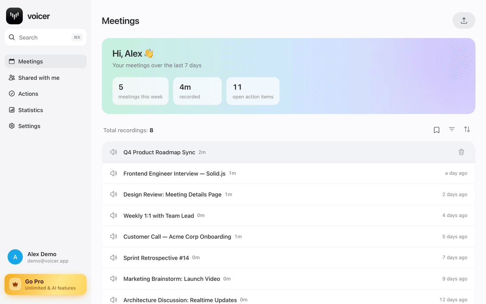
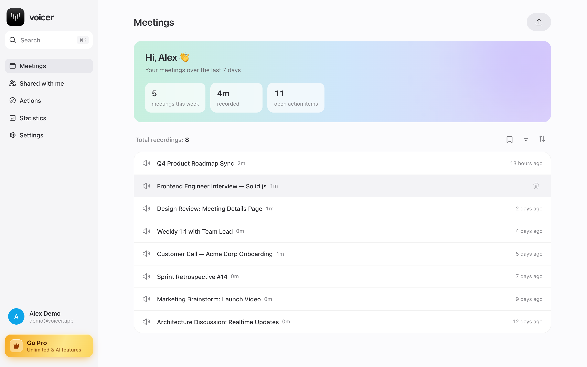
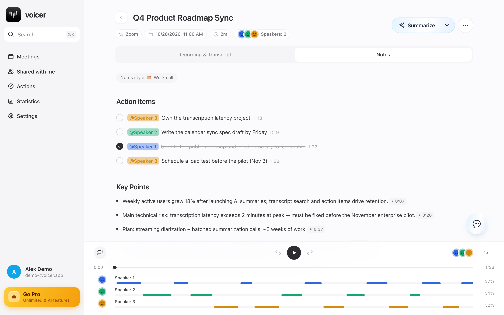
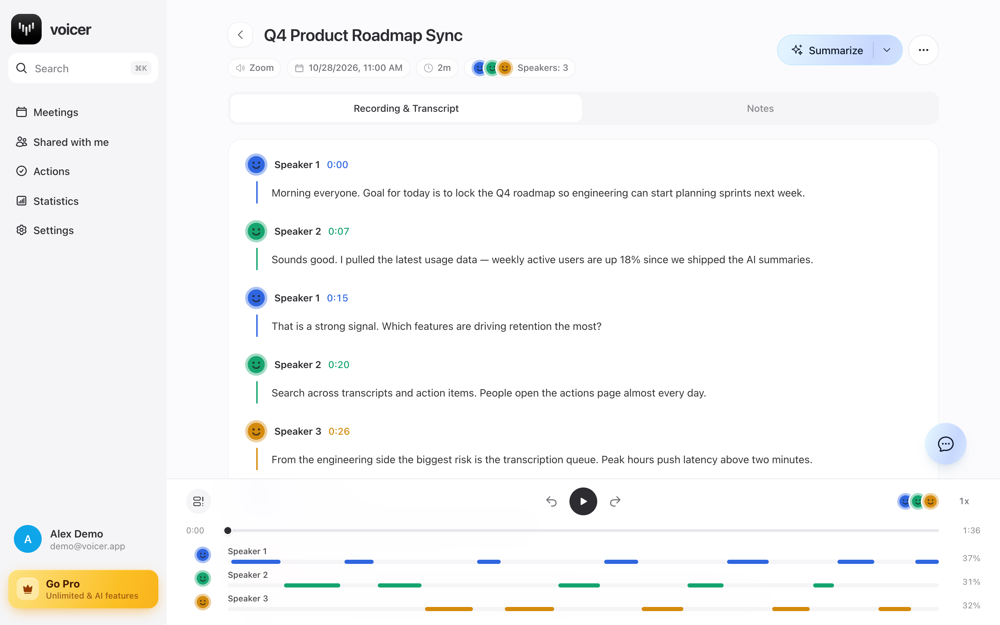
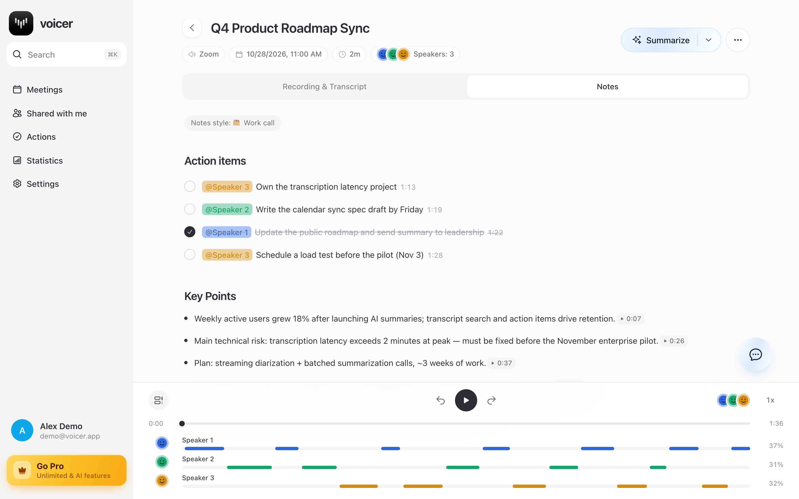
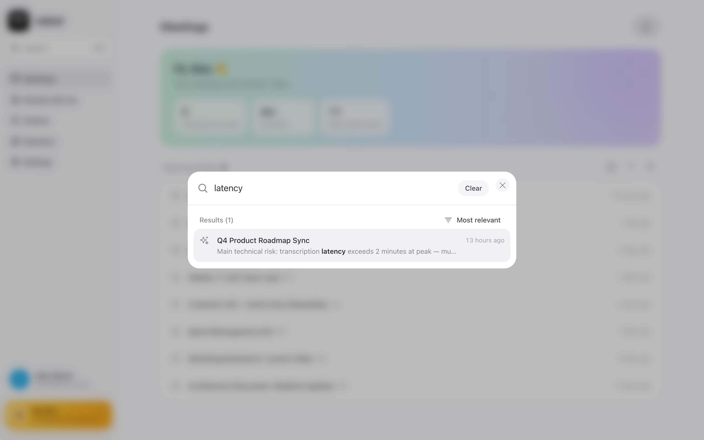
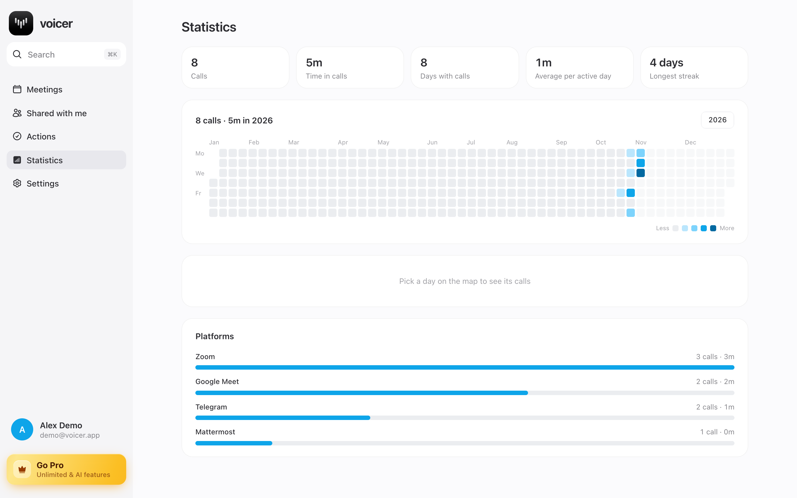

<div align="center">

# 🎙️ Voicer

**Desktop AI meeting assistant: records any call, transcribes it with speaker separation and turns it into notes, action items and a searchable archive.**

Tauri 2 · SolidJS · NestJS · GraphQL · PostgreSQL · Deepgram · Gemini



</div>

## What it does

Voicer runs in the macOS menu bar and records calls from **any** app — Zoom, Google Meet, Telegram, Mattermost — without bots joining the meeting. Your microphone and the system audio are captured on separate channels, so "me" and "them" are separated even before diarization.

After the call the audio is uploaded to your own server, transcribed and summarized automatically. Status updates arrive live over GraphQL subscriptions.

## Features

| | |
| --- | --- |
| 🎧 **Call recording** | Mic + system audio via Core Audio process tap, auto-detects the calling app |
| 📝 **Transcription** | Deepgram nova-3 with diarization — speakers, timestamps, clickable segments |
| ✨ **AI notes** | Key points with timecodes, action items with owners, auto-generated titles |
| 🎨 **Note styles** | Work call, interview, 1:1, bullets, detailed, concise… re-summarize in one click |
| 💬 **Ask the meeting** | Chat with an AI that has read the whole transcript, with suggested questions |
| ✅ **Actions** | All action items from all meetings in one checklist |
| 🔍 **Global search** | ⌘K full-text search across titles, transcripts, key points and tasks (pg_trgm) |
| 📊 **Statistics** | GitHub-style activity heatmap, streaks, time per platform |
| 🔗 **Sharing** | Share meeting notes with other users |
| 🌍 **i18n & themes** | English / Russian UI, light & dark themes |

## Screenshots

| Meetings | AI notes |
| --- | --- |
|  |  |
| **Transcript** | **Ask about the meeting** |
|  |  |
| **Search** | **Statistics** |
|  |  |

## Tech stack

**Client** — `client/`
- [Tauri 2](https://tauri.app) (Rust) — native shell, tray, autostart; audio capture through `cidre` (Core Audio / AVFoundation)
- [SolidJS](https://solidjs.com) + `@solidjs/router`, Feature-Sliced Design
- urql + GraphQL Codegen, `graphql-ws` subscriptions
- Tailwind CSS 4 + tailwind-variants, Modular Forms, `@solid-primitives/i18n`

**Server** — `server/`
- NestJS 10 + Apollo GraphQL (code-first), JWT auth (access + refresh)
- TypeORM + PostgreSQL with migrations, `pg_trgm` indexes for search
- [Deepgram](https://deepgram.com) for speech-to-text, Google Gemini for summaries and chat (with model fallback chain)
- ffmpeg transcoding, local file storage

## Architecture

```
┌──────────── Tauri app ─────────────┐         ┌──────────── NestJS ─────────────┐
│ Rust: mic + system audio capture   │ upload  │ GraphQL API (queries/mutations) │
│ SolidJS UI ── urql ────────────────┼────────►│ MeetingProcessing pipeline:     │
│            ◄── graphql-ws ─────────┼─────────┤  transcode → Deepgram → Gemini  │
└────────────────────────────────────┘ status  │ PostgreSQL (TypeORM)            │
                                               └─────────────────────────────────┘
```

## Getting started

**Requirements:** Node 20+, pnpm, PostgreSQL 15+, Rust toolchain (for the desktop build), macOS 14.4+ for system audio capture.

### 1. Server

```bash
cd server
cp .env.example .env        # set DATABASE_URL, DEEPGRAM_API_KEY, GEMINI_API_KEY
npm install
npm run migration:run
npm run start               # http://localhost:4000/graphql
```

### 2. Client

```bash
cd client
echo "VITE_GRAPHQL_API_URL=http://localhost:4000/graphql" > .env
pnpm install
pnpm dev                    # web UI at http://localhost:5173
pnpm tauri-dev              # or the full desktop app with recording
```

On first recording macOS asks for **Microphone** and **Screen & System Audio Recording** permissions; restart the app after granting them.

## Project structure

```
client/
  src/            SolidJS app (app / pages / widgets / features / entities / shared)
  src-tauri/      Rust: audio capture, tray, native commands
server/
  src/            NestJS modules: auth, meetings, transcription, summarization,
                  meeting-chat, actions, search, stats
docs/             demo GIF and screenshots
```
